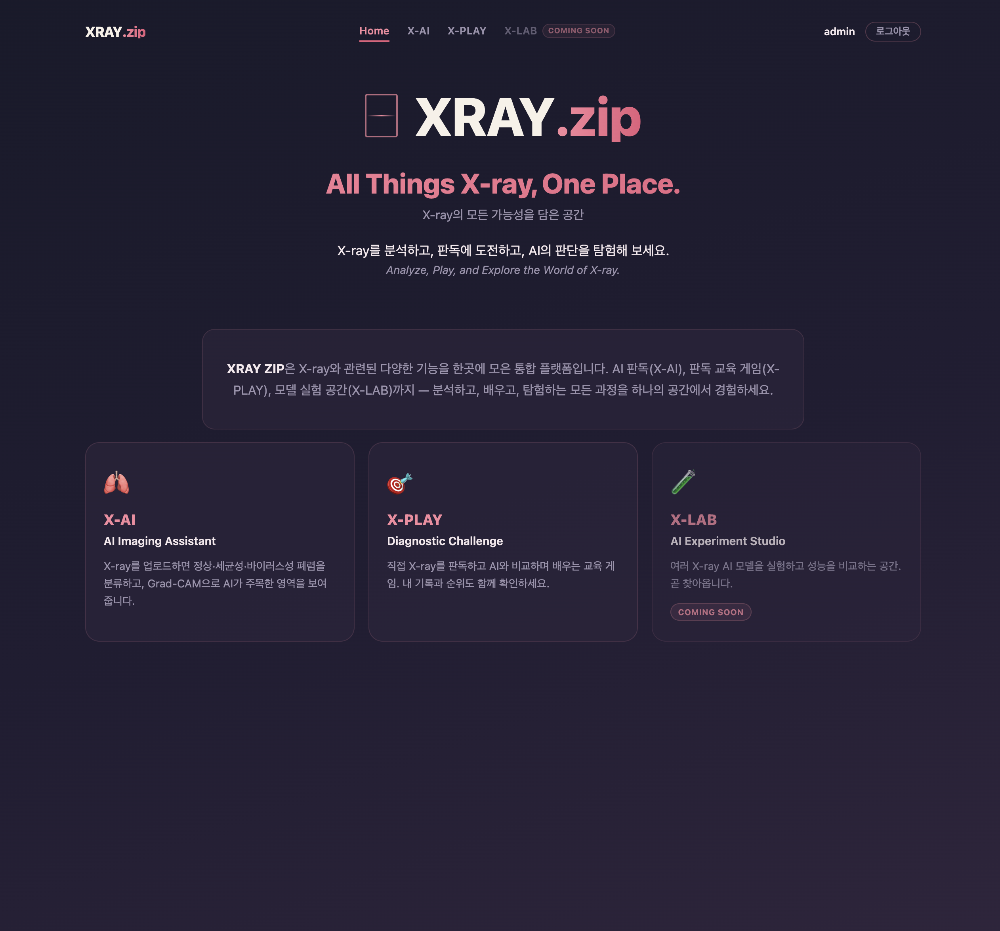
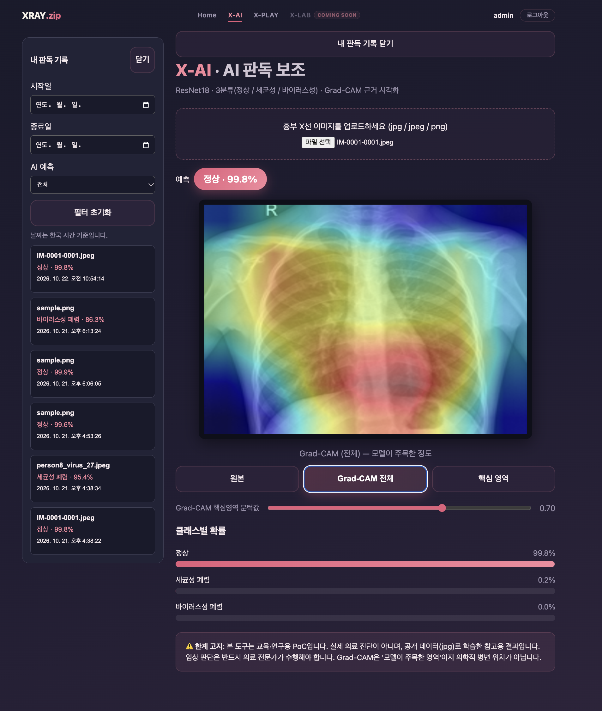
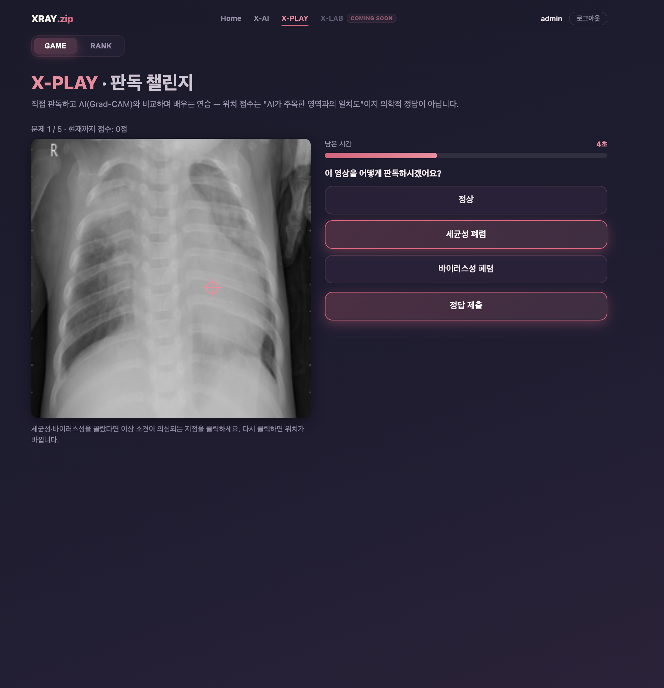
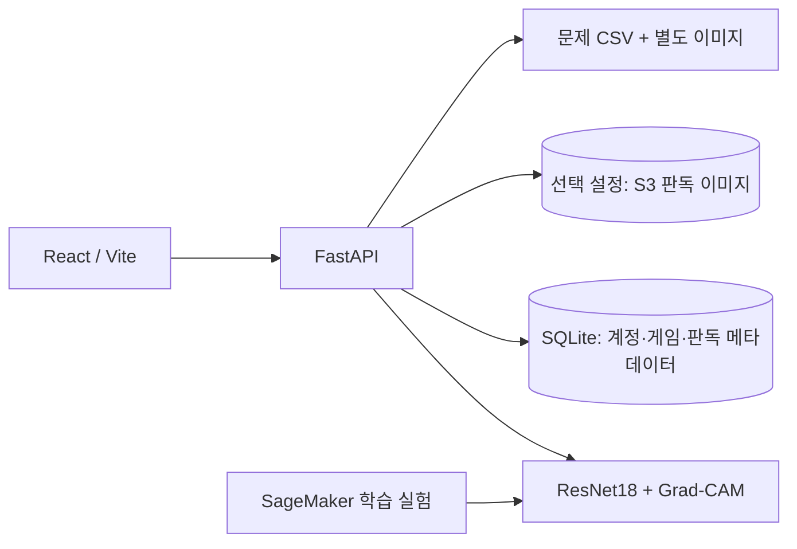

<div align="center">

# XRAY ZIP

### 흉부 X선 AI 분석과 판독 학습을 한곳에서

**ResNet18 · Grad-CAM · React · FastAPI · AWS**

교육용 흉부 X선 3분류 모델을 웹 서비스와 판독 챌린지로 연결한 프로젝트입니다.

[화면 및 시연](#화면-및-시연) · [모델 결과](#모델-결과) · [로컬 실행](#로컬-실행) · [구조](#저장소-구조)



</div>

## 프로젝트 소개

XRAY ZIP은 흉부 X선을 **정상 / 세균성 폐렴 / 바이러스성 폐렴**으로 분류하고, 모델이 주목한 영역을 Grad-CAM으로 보여주는 교육용 프로젝트입니다. 모델 학습과 평가에서 끝내지 않고, 이미지 업로드·분석·기록과 사용자가 직접 참여하는 학습 경험까지 구현했습니다.

| 기능 | 내용 | 상태 |
| --- | --- | --- |
| **X-AI** | 이미지 업로드, 클래스별 확률, Grad-CAM 전체·핵심 영역 시각화 | 구현 |
| **X-PLAY** | 5·10문제 판독 챌린지, 위치 선택, 채점 및 피드백 | 구현; 실행 시 게임 이미지 필요 |
| **기록과 통계** | 로그인, 개인 게임 기록, 순위, 판독 이력 | 구현; 판독 사진 저장은 별도 S3 설정 필요 |
| **X-LAB** | 모델 실험 공간 | 기획 단계 / Coming soon |

교육·연구용 프로토타입이며 실제 의료 진단 용도가 아닙니다. Grad-CAM은 모델의 주목 영역을 보여주며, 병변 위치의 정답이나 임상적 근거를 보장하지 않습니다.

## 화면 및 시연

<table>
<tr>
<td width="50%" align="center"><br><b>X-AI · 분류와 시각화</b></td>
<td width="50%" align="center"><br><b>X-PLAY · 직접 참여하는 판독 학습</b></td>
</tr>
</table>

- [▶ X-AI 시연 영상 — 분석 결과와 Grad-CAM (MP4)](docs/demo/x-ai.mp4)
- [▶ X-PLAY 시연 영상 — 판독 챌린지 (MP4)](docs/demo/x-play.mp4)

2026년 10월 프로젝트 시연 화면입니다. 공개용 영상은 파일 선택창·개인 기록 화면을 제외한 발췌본이며 오디오는 포함하지 않습니다. 현재 배포 중인 서비스 링크가 아닌, 구현 당시의 시연 자료입니다.

## 모델 결과

| 항목 | 값 |
| --- | --- |
| 모델 | ImageNet 사전학습 ResNet18, 3-class 출력 |
| 입력 크기 | 224 × 224 |
| 학습 | Batch 16 · 13 epochs · CosineAnnealingLR |
| 초기 학습률 / Weight decay | 0.0001 / 0.001 |
| 분할 | Train 4,439 / Validation 777 / Test 624 |
| Test accuracy | **87.66%** |
| Test macro-F1 | **0.8662** |

위 수치는 저장된 최종 실험 결과이며, 이번 공개 정리 과정에서 새로 학습하거나 측정한 결과는 아닙니다. 학습/검증 분할은 환자키 기준으로 분리했으며, 제공된 테스트 세트의 성능이 다른 병원·연령·촬영 환경으로의 일반화를 보장하지는 않습니다.

[최종 실험 설정](03_model_and_results/final/final_config.json) · [평가 지표](03_model_and_results/final/final_metrics.json) · [클래스별 결과](03_model_and_results/final/final_classification_report.csv) · [혼동 행렬](03_model_and_results/final/final_confusion_matrix.csv)

## 구성



학습은 SageMaker 환경에서, 웹 서비스는 EC2 CPU 환경에서 운영했던 구조입니다. 이 저장소는 로컬 실행용 소스와 모델·평가 결과를 제공하며 AWS 리소스를 자동 생성하지 않습니다. 기존 Streamlit 구현도 함께 보관했습니다.

## 로컬 실행

Python 3.12와 Node.js 20 이상을 권장합니다. 아래 명령은 macOS/Linux 기준이며 저장소 루트에서 시작합니다.

```bash
git clone https://github.com/jaehyeongahn01/xray-zip.git
cd xray-zip
python3.12 -m venv .venv
source .venv/bin/activate
pip install -r 05_deployment/requirements-backend.txt

# 첫 실행에서 생성할 관리자 계정의 비밀번호를 직접 지정합니다.
read -s -p 'Initial admin password: ' ADMIN_PASSWORD; echo
export ADMIN_PASSWORD
bash 05_deployment/run_backend.sh
```

위 비밀번호 입력은 **Bash** 문법입니다. zsh에서는 `read -s 'ADMIN_PASSWORD?Initial admin password: '` 후 `export ADMIN_PASSWORD`를 사용하세요. 기본 관리자 ID는 `admin`이며 기존 계정이 있으면 환경변수 변경만으로 비밀번호가 바뀌지 않습니다.

다른 터미널에서:

```bash
cd xray-zip/02_web_service/frontend
npm ci
npm run dev
```

브라우저에서 `http://localhost:5173`을 엽니다. API는 `http://127.0.0.1:8000`, 상태 확인은 `/api/health`입니다. 프론트엔드에서 `npm run build`를 실행하면 FastAPI가 빌드된 화면도 제공합니다.

### 데이터 및 선택 설정

- **모델 가중치 포함:** `03_model_and_results/best_model.pth`.
- **원본 데이터와 게임 이미지 미포함:** [데이터 안내](04_dataset/README.md)에 출처·접근 조건·복원 방법을 정리했습니다. 게임을 실행하려면 `images/`, `overlay/`를 별도로 복원해야 합니다.
- **S3는 선택 설정:** 판독 사진·이력을 저장하려면 본인 버킷의 `CXR_S3_BUCKET`, `CXR_S3_PREFIX`, `AWS_REGION`과 해당 버킷에 대한 권한을 설정하세요. 설정하지 않으면 추론 결과는 표시되지만 이력 저장 실패 안내가 나타날 수 있습니다.
- **로컬 기록:** SQLite는 첫 실행에 생성되며 Git에 포함되지 않습니다. `CXR_DATA_DIR`로 저장 위치를 바꿀 수 있습니다.
- **Streamlit:** `05_deployment/requirements-streamlit.txt` 설치 후 `bash 05_deployment/run_streamlit.sh`.

## 저장소 구조

```text
01_model_training/       최종 학습·Grad-CAM 노트북, v1–v7 실험, 평가 코드
02_web_service/          React 프론트엔드, FastAPI 백엔드, Streamlit 구현
03_model_and_results/    모델 가중치, 실험 설정과 평가 결과
04_dataset/              라벨·분할 CSV, 게임 문제 목록, 데이터 복원 안내
05_deployment/           의존성과 로컬 실행 스크립트
docs/images/             실제 앱 화면
docs/demo/               공개용 시연 영상
```

## 실행·공개 범위

이 저장소는 포트폴리오 및 교육용 코드 공개입니다. 운영 서비스 인증·보안 검증을 마쳤다는 의미는 아닙니다. 공개 서버로 운영하려면 HTTPS, 인증과 비밀번호 저장 방식 강화, 요청 제한, 데이터 보관 정책 등을 별도로 검토해야 합니다. 체크포인트는 신뢰하는 출처의 파일만 사용하세요.

원본 의료 영상, 운영 회원 DB·세션·업로드 자료, AWS 자격증명 및 SSH 개인키는 포함하지 않습니다. 화면에 쓰인 의료 이미지는 교육 데이터의 시연 예시이며 데이터셋 자체를 재배포하는 패키지는 아닙니다. 외부 데이터·사전학습 가중치의 이용 조건은 원 출처를 따릅니다. 별도의 오픈소스 라이선스는 아직 지정하지 않았습니다.
